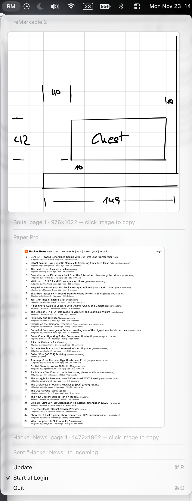

# RM-Clipper

A macOS menu bar app for the reMarkable 2 and Paper Pro.

- **Clip:** shows the page open on the tablet. Click the preview to copy it to the clipboard, cropped to the ink.
- **Print (Paper Pro):** adds a printer to your Mac. Whatever you print lands as a PDF in the tablet's "Incoming" folder, fitted to its screen and clear of the menu.



It talks to the tablet directly over SSH: no cloud, nothing installed on the tablet. Early stage, tested only on macOS 27 with tablet software 3.29. Not affiliated with reMarkable.

## You need

- macOS 13 or later with the Xcode Command Line Tools (`xcode-select --install`).
- SSH access to the tablet. The reMarkable 2 has it; the Paper Pro needs developer mode (Settings → General → Paper Tablet → Software → Advanced), which **erases the tablet** and shows a warning at every boot.
- The USB web interface switched on in the tablet's storage settings.
- An SSH key at `~/.ssh/id_ed25519` without a passphrase, or loaded in your SSH agent.

## Set up the tablet

Connect it by USB. The root password is on the tablet, in the Copyrights and Licenses page of the Help settings.

Paper Pro (the alias keeps it apart from a reMarkable 2, which has the same USB address):

```sh
cat ~/.ssh/id_ed25519.pub | ssh -o HostKeyAlias=rmpp root@10.11.99.1 'mkdir -p -m 700 ~/.ssh && cat >> ~/.ssh/authorized_keys && chmod 600 ~/.ssh/authorized_keys'
ssh -o HostKeyAlias=rmpp root@10.11.99.1 rm-ssh-over-wlan on
```

reMarkable 2: the same two commands without `-o HostKeyAlias=rmpp`.

For printing, create a folder named "Incoming" at the top level of the Paper Pro.

## Build and run

```sh
git clone https://github.com/octets-eu/rm-clipper.git
cd rm-clipper
./build.sh run       # build and start; allow Local Network access when asked
./printer.sh add     # optional: adds the printer and makes it your default
```

The app looks for the tablet at its last known address and over USB, and searches your local network if it is not there. To set the address yourself: `defaults write local.rm-clipper rmpp.host <ip>` (`rm2.host` for the reMarkable 2), then restart the app.

## Good to know

- A sleeping tablet is unreachable. Prints wait and are sent when it wakes up. If the app is not running, macOS holds them.
- The printer listens only on your own Mac.
- In Safari, print articles from Reader view; normal pages may come out cut up or incomplete.
- Grey ink cannot be told apart from grey page templates when cropping.

## Remove

Run `./printer.sh remove`, untick Start at Login in the RM menu, quit, and delete the folder and `~/Library/Application Support/RM-Clipper`.

## License

MIT, see [LICENSE](LICENSE).
